# Kiddo — Pebble Time, Time Round, Time 2 & Round 2

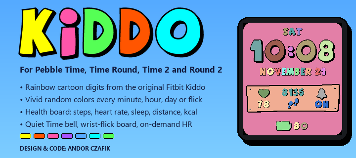

A native C port of the original Fitbit **Kiddo** clockface (Design & Code: **Andor Czafik**) for **Pebble Time (`basalt`, 144×168)**, **Pebble Time Round (`chalk`, 180×180 round)**, **Pebble Time 2 (`emery`, 200×228)** and **Pebble Round 2 (`gabbro`, 260×260 round)**.

Playful cartoon digits and letters, every one in its own random color with a black outline and 3D shadow, a wooden health board with nails, and a colorful battery — rendered from the original Fitbit artwork.

**Download latest release:** [Kiddo-1.0.0.pbw](https://github.com/czandor/Kiddo-Clockface-Pebble/releases/latest) (also in `dist/Kiddo-1.0.0.pbw` with `dist/SHA256SUMS.txt`)

## Features

- **Rainbow letters:** time, weekday, AM/PM, date and battery are drawn from the original Kiddo glyphs. Every letter can get its own random color (default), one random color per text, or one fixed color.
- **Always vivid background and board:** picked from the 29 vivid palette entries, while letters, numbers and icons may use any of the 50 Kiddo colors that clearly differ (CIE76 ≥ 50) from the surface below them.
- **Background color like Blokk:** *Choose one color*, *Random every day*, *Random every hour*, *Random every minute* (default) or *Random on wrist flick*. The random letter and board colors change together with the background.
- **Health board with 6 slots** (3 on the main board, 3 on the second board): heart rate (Pebble Time 2), steps, active minutes, distance (km or mi), calories, sleep hours, or the vibration bell.
- **Quiet Time indicator on screen by default:** a bell with `ON` while the watch may vibrate, a crossed bell with `OFF` while Quiet Time is active.
- **Wrist flick:** shows the second board for 20 seconds, optionally with a short vibration (silent in Quiet Time by default).
- **Heart rate on wrist flick (Pebble Time 2):** optional on-demand measurement (1 Hz sampling for up to 45 s until two consistent readings); the heart blinks while measuring. Watches without a heart-rate sensor never offer the heart-rate options.
- **Battery:** colored by charge level, blue with a trailing `+` while charging.
- **Round layouts** for Pebble Time Round and Round 2, with the weekday and AM/PM pulled in from the edge.
- **Offline Clay settings** in the Pebble phone app (`@rebble/clay`).

## Screenshots

| Pebble Time 2 | Pebble Time 2 (second board) | Pebble Time 2 (real watch, Quiet Time) | Pebble Time | Pebble Time (12h) |
| :---: | :---: | :---: | :---: | :---: |
| 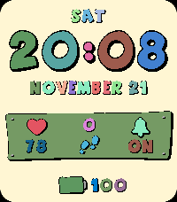 | 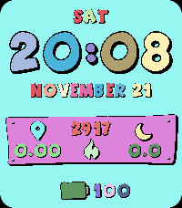 | 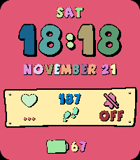 | 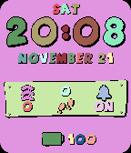 | 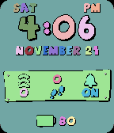 |

| Pebble Round 2 | Pebble Round 2 (12h) | Pebble Time Round | Pebble Time Round (12h) | Pebble Time Round (second board) |
| :---: | :---: | :---: | :---: | :---: |
| 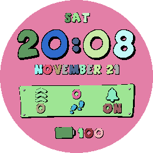 | 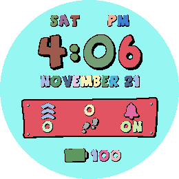 | 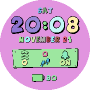 | 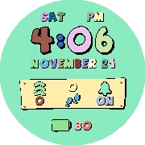 | 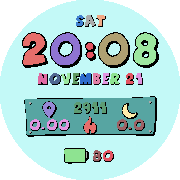 |

## Repository Structure

| Path | Contents |
| --- | --- |
| `pebble/` | Native Pebble C source (`src/c/main.c`, generated `src/c/glyphs.h`), PebbleKit JS (`src/pkjs/`), offline Clay configuration and the generated glyph sprite sheets (`resources/images/`). |
| `dist/` | Compiled `Kiddo-*.pbw` builds and `SHA256SUMS.txt`. |
| `tools/` | Glyph and color generators (`make-glyphs.py`, `make-colors.py`), store art (`make-store.py`, `store-shots.sh`), build scripts (`build.ps1`, `build.sh`), manifest/config generator (`prepare-project.cjs`), emulator screenshot script and unit tests (`test.cjs`). |
| `store/` | Appstore listing text (`STORE_TEXT.md`), banner, icons and screenshots for every platform. |
| `docs/` | Developer handoff (`FEJLESZTES.md`), changelog (`VALTOZASOK.md`), validation notes (`VALIDATION.md`) and emulator screenshots. |
| `original/` | Local, unversioned Fitbit Kiddo reference source and artwork. |

## Building & Testing

On Windows (using the shared WSL `NineTimeSDK` environment):

```powershell
python -P tools/make-glyphs.py
powershell -ExecutionPolicy Bypass -File tools/build.ps1
node tools/test.cjs
```

## Credits

Design & Code: Andor Czafik. The digits and letters are pre-rendered bitmaps of the original Fitbit Kiddo artwork, made with the *Agent Orange* font by Jakob Fischer (pizzadude.dk); the font file itself is not distributed.
